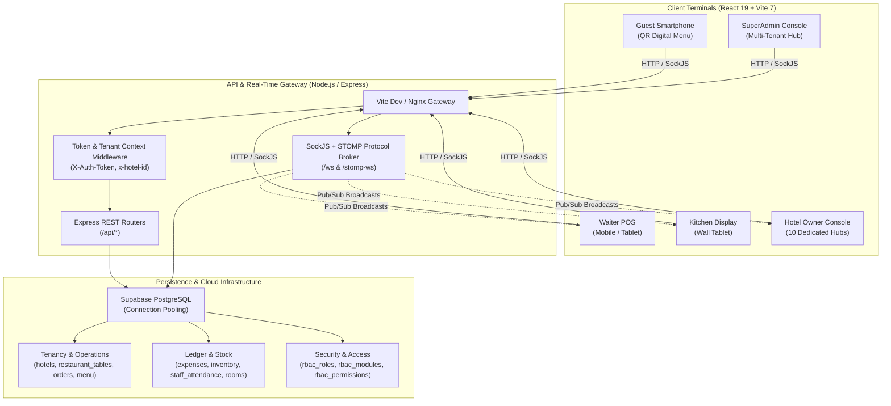
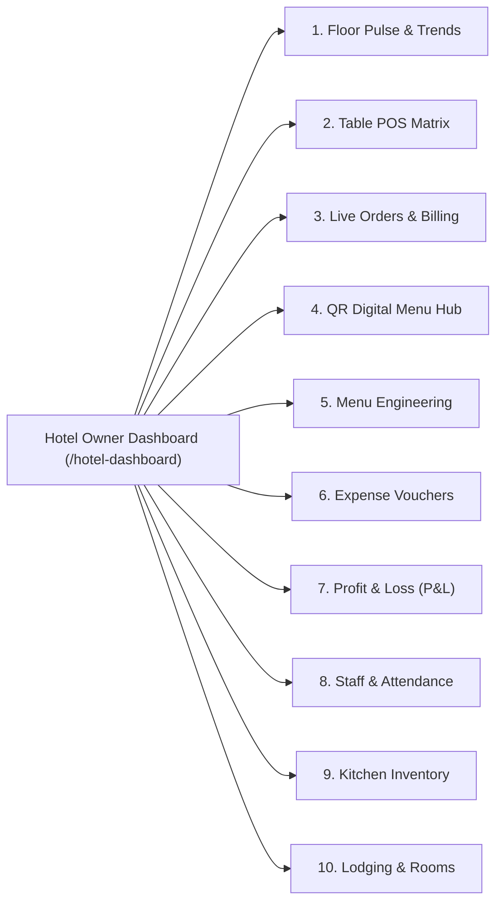

# Functional & Technical Requirements Specification (FRD / TRD)
## Multi-Tenant Hotel & Restaurant Management Operating System (AURA Restaurant OS)

---

## Document Control

| Property | Details |
| :--- | :--- |
| **Document Title** | Functional & Technical Requirements Document (FRD / TRD) |
| **System Name** | AURA Dining & Hotel Management System (Restaurant OS) |
| **Document Version** | 2.0.0 (Comprehensive Multi-Tenant & POS Release) |
| **Status** | Production Ready / Approved Architecture |
| **Target Audience** | Product Managers, Software Architects, Full-Stack Developers, QA Engineers, DevOps Engineers, Hotel Operators |
| **Technology Stack** | React 19, Vite 7, Node.js (ESM), Express, Supabase PostgreSQL, SockJS / STOMP WebSockets, Tailwind CSS v4 |
| **Primary Reference Property** | Hotel Lay Bhari (`slug: laybhari`, `id: 0a4fabc0-0b95-467b-a22c-252aec59f9c7`, Currency: ₹ INR) |
| **Last Updated** | November 2026 |

---

## 1. Executive Summary & Product Architecture

### 1.1 Product Vision
AURA Restaurant OS is a cloud-native, real-time, multi-tenant hospitality operating system engineered for high-turnover restaurants, dining floors, and boutique hotel properties. The system eliminates costly proprietary POS hardware and complex local servers by providing responsive web applications across any smartphone, tablet, or desktop.

### 1.2 Core Architectural Principles
1. **Multi-Tenancy with Data Isolation**: Every hotel/restaurant operates as an independent tenant with its own branding, currency (₹, $, €, etc.), tax rates, table layouts, menu items, staff rosters, and financial ledgers, partitioned by `hotel_id` across all relational tables.
2. **Zero-Polling Real-Time Sync**: An embedded SockJS + STOMP protocol broker dispatches table status updates, order modifications, kitchen queue shifts, and floor notifications across all connected terminals in under 100ms.
3. **Streamlined Single-Stage Owner Ordering**: For high-speed counter and owner operations, orders placed by hotel owners transition directly to `SERVED` (Delivered to Customer), bypassing unnecessary kitchen prep delays while retaining full inventory decrementing and financial recording.
4. **Soft Lifecycle Governance**: System entities (tables, menu items, staff, inventory) use an **Active / Inactive** toggle state rather than hard destructive deletes, preserving historical sales logs, tax compliance trails, and accounting integrity.
5. **Universal Hardware Compatibility**: Responsive touch interfaces designed for Android/iOS mobile devices, kitchen wall tablets, desktop POS terminals, and 58mm/80mm thermal receipt printers via standard browser printing protocols.

### 1.3 Recent Core Functional & Architectural Changes (v2.1.0 Updates)
The following major functional improvements were recently engineered, deployed, and verified:
1. **Single-Stage Direct Delivery for Owner Orders (`SERVED`)**:
   - For fast counter and table operations executed by the Hotel Owner, orders bypass multi-stage kitchen delays (`PLACED` $\rightarrow$ `PREPARING` $\rightarrow$ `READY`).
   - Items added directly by the owner are immediately stamped with status `SERVED` (Delivered to Table), reflecting instant floor service while recording financial transactions and table occupancy.
   - Simplified the ordering drawer actions to a single prominent button: `+ Confirm & Deliver to Table` (or `+ Add & Deliver to Table` when appending dishes).
2. **Comprehensive Thermal Receipt & KOT Print Layout**:
   - Resolved missing pricing and financial metrics in the browser print modal (`window.print()`).
   - Formatted itemized receipt tables with: Item Name, Quantity (`2x`), Unit Rate (`₹250.00`), Line Subtotal (`₹500.00`), Consolidated Subtotal, Tax / GST breakdown (10%), and bold Grand Total (`TOTAL BILL`).
3. **Kitchen Inventory Management (Add Stock & 1-Click Restock)**:
   - Implemented frontend form submission handlers `handleAddInventorySubmit` and `handleRestockSubmit`.
   - Connected `POST /api/hotel-owner/inventory` and `PUT /api/hotel-owner/inventory/:id`.
   - Built automatic stock level re-evaluation in PostgreSQL: updating stock quantities automatically synchronizes the item status between `IN_STOCK` and `LOW_STOCK` without manual status toggles.
   - Synchronized response key structures (`inventory` & `items`, `stats` & flat metrics) across client and server.
4. **Table Floor Plan: Strict Table Duplicate Prevention**:
   - Enforced unique table number and unique table name constraints at both the database level (`UNIQUE(hotel_id, number)`) and the API layer (`DUPLICATE_TABLE_NUMBER`).
   - Prevents duplicate tables with inline warning feedback.
5. **Soft Lifecycle Governance (Active / Inactive)**:
   - Replaced destructive hard `DELETE` operations across Tables, Inventory Items, Menu Dishes, Staff, and Expense Vouchers with an `Active / Inactive` status toggle.
   - Preserves historical sales records, invoice ledgers, audit trails, and foreign key integrity.
6. **LayBhari Multi-Tenant Context (`owner_laybhari`)**:
   - Streamlined authentication headers (`X-Auth-Token`, `x-hotel-id`) with automatic tenant scoping for Hotel Lay Bhari (`0a4fabc0-0b95-467b-a22c-252aec59f9c7`, currency ₹ INR).

---

## 2. High-Level System Architecture



---

## 3. Database Schema & Data Dictionary

All tables are persisted in Supabase PostgreSQL with UUID primary keys and foreign key constraints enforcing tenant isolation.

### 3.1 Tenancy & Authentication Schema

#### `hotels`
| Column | Type | Constraints | Description |
| :--- | :--- | :--- | :--- |
| `id` | UUID | PRIMARY KEY, DEFAULT gen_random_uuid() | Unique hotel property identifier |
| `name` | VARCHAR(255) | NOT NULL | Registered property name (e.g., "Hotel Lay Bhari") |
| `slug` | VARCHAR(100) | UNIQUE, NOT NULL | URL-safe slug for routing (e.g., "laybhari") |
| `currency` | VARCHAR(10) | DEFAULT 'INR' | Default display currency (INR, USD, EUR) |
| `status` | VARCHAR(50) | DEFAULT 'ACTIVE' | Operational status: ACTIVE / INACTIVE |
| `created_at` | TIMESTAMPTZ | DEFAULT NOW() | Record creation timestamp |

#### `app_users`
| Column | Type | Constraints | Description |
| :--- | :--- | :--- | :--- |
| `id` | VARCHAR(50) | PRIMARY KEY | Unique user ID (string or integer representation) |
| `hotel_id` | UUID | REFERENCES hotels(id) ON DELETE CASCADE | Associated hotel tenant (NULL for SuperAdmin) |
| `username` | VARCHAR(100) | UNIQUE, NOT NULL | Login username |
| `password` | VARCHAR(255) | NOT NULL | Plain or hashed authentication password |
| `role` | VARCHAR(50) | NOT NULL | System baseline role: SUPER_ADMIN, HOTEL_OWNER, MANAGER, WAITER, KITCHEN |
| `full_name` | VARCHAR(255) | | Employee or owner full name |
| `email` | VARCHAR(255) | | Contact email address |
| `status` | VARCHAR(50) | DEFAULT 'ACTIVE' | User account state: ACTIVE / INACTIVE |
| `created_at` | TIMESTAMPTZ | DEFAULT NOW() | Record creation timestamp |

#### `auth_tokens`
| Column | Type | Constraints | Description |
| :--- | :--- | :--- | :--- |
| `token` | VARCHAR(255) | PRIMARY KEY | Bearer / `X-Auth-Token` session token |
| `user_id` | VARCHAR(50) | NOT NULL | Associated user ID |
| `created_at` | TIMESTAMPTZ | DEFAULT NOW() | Token issue timestamp |

---

### 3.2 Restaurant & Dining Operations Schema

#### `restaurant_tables`
| Column | Type | Constraints | Description |
| :--- | :--- | :--- | :--- |
| `id` | VARCHAR(50) | PRIMARY KEY | Unique table ID (e.g., "t1", "t2", or UUID) |
| `hotel_id` | UUID | REFERENCES hotels(id) ON DELETE CASCADE | Tenant property ID |
| `number` | INTEGER | NOT NULL | Table number (strictly unique per hotel) |
| `name` | VARCHAR(100) | NOT NULL | Visual display name (e.g., "Table 1", "VIP 4") |
| `capacity` | INTEGER | DEFAULT 4 | Seating capacity |
| `status` | VARCHAR(50) | DEFAULT 'AVAILABLE' | Occupancy state: AVAILABLE, OCCUPIED, RESERVED |
| `current_order_id` | VARCHAR(50) | | Reference to active unpaid order |
| `is_active` | BOOLEAN | DEFAULT TRUE | Soft toggle: TRUE (Active), FALSE (Inactive) |

#### `menu_items`
| Column | Type | Constraints | Description |
| :--- | :--- | :--- | :--- |
| `id` | VARCHAR(50) | PRIMARY KEY | Unique menu dish identifier |
| `hotel_id` | UUID | REFERENCES hotels(id) ON DELETE CASCADE | Tenant property ID |
| `name` | VARCHAR(255) | NOT NULL | Dish title (e.g. "Special Kolhapuri Tambada Rassa") |
| `description` | TEXT | | Ingredients and culinary preparation notes |
| `price` | NUMERIC(10, 2) | NOT NULL | Selling price per portion |
| `category` | VARCHAR(100) | NOT NULL | Category (Starters, Main Course, Breads, Rice, Desserts) |
| `image_url` | TEXT | | Image asset URL |
| `is_veg` | BOOLEAN | DEFAULT FALSE | Dietary classification: TRUE (Veg), FALSE (Non-Veg) |
| `is_bestseller` | BOOLEAN | DEFAULT FALSE | Flag indicating chef specialty / bestseller pin |
| `is_available` | BOOLEAN | DEFAULT TRUE | Real-time ordering availability toggle |

#### `orders`
| Column | Type | Constraints | Description |
| :--- | :--- | :--- | :--- |
| `id` | VARCHAR(50) | PRIMARY KEY | Unique order number (e.g., "#494650") |
| `hotel_id` | UUID | REFERENCES hotels(id) ON DELETE CASCADE | Tenant property ID |
| `table_number` | INTEGER | NOT NULL | Assigned dining table number |
| `items` | JSONB | NOT NULL | Array of item objects: `[{ id, name, price, quantity }]` |
| `total_amount` | NUMERIC(10, 2) | NOT NULL | Calculated gross order amount (Sum of item subtotals) |
| `tax_amount` | NUMERIC(10, 2) | DEFAULT 0 | Calculated GST/tax percentage (e.g. 10%) |
| `final_bill` | NUMERIC(10, 2) | NOT NULL | Grand total payable (`total_amount + tax_amount`) |
| `status` | VARCHAR(50) | NOT NULL | State machine: PLACED, PREPARING, READY, SERVED, PAID, CANCELLED |
| `created_at` | TIMESTAMPTZ | DEFAULT NOW() | Order placement timestamp |
| `updated_at` | TIMESTAMPTZ | DEFAULT NOW() | Last stage update timestamp |

---

### 3.3 Financials, Inventory & Staff Schema

#### `restaurant_expenses`
| Column | Type | Constraints | Description |
| :--- | :--- | :--- | :--- |
| `id` | UUID | PRIMARY KEY, DEFAULT gen_random_uuid() | Unique expense voucher identifier |
| `hotel_id` | UUID | REFERENCES hotels(id) ON DELETE CASCADE | Tenant property ID |
| `title` | VARCHAR(255) | NOT NULL | Description (e.g., "Daily Chicken & Mutton Purchase") |
| `category` | VARCHAR(100) | NOT NULL | Category (Raw Materials, Groceries, Fuel, Wages, Maintenance) |
| `amount` | NUMERIC(10, 2) | NOT NULL | Expenditure amount in hotel currency |
| `expense_date` | DATE | NOT NULL, DEFAULT CURRENT_DATE | Incurred date |
| `payment_method` | VARCHAR(50) | DEFAULT 'CASH' | Payment type: CASH, UPI, BANK_TRANSFER, CHEQUE |
| `notes` | TEXT | | Invoice / receipt notes |
| `status` | VARCHAR(50) | DEFAULT 'ACTIVE' | Soft lifecycle: ACTIVE / INACTIVE |
| `created_at` | TIMESTAMPTZ | DEFAULT NOW() | Voucher record timestamp |

#### `restaurant_inventory`
| Column | Type | Constraints | Description |
| :--- | :--- | :--- | :--- |
| `id` | UUID | PRIMARY KEY, DEFAULT gen_random_uuid() | Unique raw material identifier |
| `hotel_id` | UUID | REFERENCES hotels(id) ON DELETE CASCADE | Tenant property ID |
| `item_name` | VARCHAR(255) | NOT NULL | Material name (e.g., "Indrayani Rice", "Refined Sunflower Oil") |
| `category` | VARCHAR(100) | NOT NULL | Category (Grains & Rice, Meat, Dairy, Vegetables, Spices, Gas) |
| `quantity` | NUMERIC(10, 2) | NOT NULL, DEFAULT 0 | Current stock on hand |
| `unit` | VARCHAR(50) | NOT NULL, DEFAULT 'kg' | Unit of measure: kg, litres, cylinders, packets |
| `min_threshold` | NUMERIC(10, 2) | NOT NULL, DEFAULT 5 | Minimum buffer level triggering low-stock alert |
| `cost_per_unit` | NUMERIC(10, 2) | DEFAULT 0 | Procurement purchase cost per unit |
| `status` | VARCHAR(50) | DEFAULT 'IN_STOCK' | Status: IN_STOCK, LOW_STOCK, OUT_OF_STOCK, INACTIVE |
| `last_restocked` | TIMESTAMPTZ | DEFAULT NOW() | Last replenishment timestamp |
| `created_at` | TIMESTAMPTZ | DEFAULT NOW() | Initial item creation timestamp |

#### `hotel_staff` & `hotel_staff_attendance`
- **`hotel_staff`**: Holds employee profile (`full_name`, `role_title`, `phone`, `shift`, `salary`, `status`).
- **`hotel_staff_attendance`**: Tracks day-level attendance (`staff_id`, `attendance_date`, `status` [PRESENT, HALF_DAY, ABSENT, ON_LEAVE], `shift`, `verified_by`).

#### `hotel_rooms` & `hotel_bookings`
- **`hotel_rooms`**: Secondary lodging module managing room numbers, room categories (Deluxe, Suite, Standard), base tariffs, and housekeeping readiness.
- **`hotel_bookings`**: Guest reservation records with check-in/out dates, guest contact information, total room tariffs, and folio billing.

---

## 4. User Personas & Permissions Matrix

| Module / Action | Guest (Public QR) | Waiter POS | Kitchen KDS | Restaurant Manager | Hotel Owner (`owner_laybhari`) | Super Admin (`superadmin`) |
| :--- | :---: | :---: | :---: | :---: | :---: | :---: |
| **Browse Menu by Slug** | ✅ | ✅ | ✅ | ✅ | ✅ | ✅ |
| **Submit Customer Order** | ✅ | ✅ | ❌ | ✅ | ✅ | ✅ |
| **Kitchen Queue (KDS)** | ❌ | ❌ | ✅ | ✅ | ✅ | ✅ |
| **Update Stage (Prep $\rightarrow$ Ready)** | ❌ | ❌ | ✅ | ✅ | ✅ | ✅ |
| **Waiter POS Delivery** | ❌ | ✅ | ❌ | ✅ | ✅ | ✅ |
| **Direct 1-Click Order (Served)** | ❌ | ❌ | ❌ | ✅ | ✅ | ✅ |
| **Append / Remove Order Items** | ❌ | ✅ | ❌ | ✅ | ✅ | ✅ |
| **Print Thermal Receipt / KOT** | ❌ | ✅ | ❌ | ✅ | ✅ | ✅ |
| **Bill Settlement (`PAID`)** | ❌ | ✅ | ❌ | ✅ | ✅ | ✅ |
| **Table Management & Duplicate Block** | ❌ | ❌ | ❌ | ✅ | ✅ | ✅ |
| **Menu Engineering & Pricing** | ❌ | ❌ | ❌ | ✅ | ✅ | ✅ |
| **Log Expense Vouchers** | ❌ | ❌ | ❌ | ✅ | ✅ | ✅ |
| **View P&L Profitability** | ❌ | ❌ | ❌ | ❌ | ✅ | ✅ |
| **Staff & Shift Attendance** | ❌ | ❌ | ❌ | ✅ | ✅ | ✅ |
| **Kitchen Inventory & Restock** | ❌ | ❌ | ❌ | ✅ | ✅ | ✅ |
| **Tenant Property Onboarding** | ❌ | ❌ | ❌ | ❌ | ❌ | ✅ |
| **RBAC Roles & Permissions** | ❌ | ❌ | ❌ | ❌ | ❌ | ✅ |

---

## 5. Functional Specifications: Hotel Owner Dashboard (`/hotel-dashboard`)

The Hotel Owner Dashboard is divided into 10 purpose-built operational hubs:



### 5.1 Tab 1: Dining Floor Operations & Sales Trends
* **Financial Gauges**: Displays live metrics for Today's Sales, Total Orders, Active Kitchen Queue, Completed Orders, Total Operational Expenses, Gross Profit, and Net Margin.
* **Table Floor Pulse**: Compact visual status of every dining table (Green = Free, Amber = Occupied, Blue = Reserved).
* **Historical Trend Graph**: Toggles turnover across Daily, Weekly, and Monthly periods.
* **Low Stock Warning Banner**: Proactively warns the owner if any raw materials or LPG cylinders are below minimum safety thresholds.

### 5.2 Tab 2: Table Floor Matrix & POS Management
* **Visual Table Matrix**: Shows table cards with guest capacities, real-time status, and linked active order IDs.
* **Table Creation & Duplicate Prevention**:
  * Enforces numeric and name uniqueness across tenant tables.
  * Rejects duplicate table numbers with clear visual feedback: `"Table X already exists in this hotel"`.
* **Soft Lifecycle**: Dedicated Active / Inactive toggle button per table to archive tables without breaking historical order joins.

### 5.3 Tab 3: Order Management & 1-Click Direct Delivery
* **Single-Stage Owner Flow**: For fast counter-service, items added to a table order are automatically designated as `SERVED` (Delivered to Customer), eliminating unnecessary intermediate kitchen staging for owner orders.
* **Dish Modification**:
  * Real-time search across menu items with Category and Pure Veg / Non-Veg filters.
  * Append new dishes to an existing active table order with instant subtotal and tax updates.
  * Remove mistakenly added items with automatic bill readjustment.
* **Bill Settlement & Printing**:
  * Thermal KOT and Customer Receipt print layouts formatted for 58mm/80mm receipt printers.
  * Formatted tabular itemization: Quantity, Dish Name, Rate per portion, Line Amount, Subtotal, Tax/GST (10%), and Grand Total.

### 5.4 Tab 4: QR Code & Contactless Ordering
* Generates downloadable SVG/PNG QR codes pre-encoded with direct ordering URLs (`/menu?table=tN` or `/:slug/menu?table=tN`).
* Enables instant customer self-service with zero waitstaff intervention required.

### 5.5 Tab 5: Restaurant Menu Engineering
* Add, edit, or toggle availability of dishes.
* Assign Category, Pricing, Description, Veg/Non-Veg tag, and Chef's Bestseller pin.
* Dynamic sorting by category with real-time sync across customer mobile menus.

### 5.6 Tab 6: Restaurant Expenses & Vouchers
* Digital logging of daily expenses: Title, Category (Raw Materials, Groceries, Dairy, Meat, Fuel & Utilities, Wages, Maintenance), Amount, Date, and Payment Method.
* Aggregates expenses by category to visualize cost drivers and leaks.
* Active / Inactive soft toggle for auditing corrections.

### 5.7 Tab 7: Profit & Loss (P&L) Reports
* Real-time net margin calculations:
  $$\text{Net Margin} = \text{Gross Dining Turnover} - \text{Raw Material COGS} - \text{Operational Expenses}$$
* Breakdown by reporting periods: Today, This Week, This Month.
* Visual progress bars comparing revenue versus total expenses.

### 5.8 Tab 8: Staff & Daily Shift Attendance Roster
* Staff directory detailing roles, shift allocations (Morning, Evening, Night), and salaries.
* Daily attendance logging with status pills: Present, Half Day, Absent, On Leave.
* **1-Click Batch Attendance**: "Mark All Present" button automatically marks all active employees present for the selected date.
* Per-employee historical attendance records.

### 5.9 Tab 9: Kitchen Inventory & Restock Management
* Real-time inventory tracking for ingredients, meats, dairy, spices, and LPG cylinders.
* **Low Stock Alerts**: Automatically triggers visual warnings when `quantity <= min_threshold`.
* **1-Click Restock**:
  * Modal input accepts quantity to add.
  * Computes `new_quantity = current_quantity + added_quantity`.
  * Dynamically updates status column in PostgreSQL (`IN_STOCK` vs `LOW_STOCK`).
* Total Stock Asset Valuation:
  $$\text{Total Valuation} = \sum (\text{Quantity} \times \text{Cost Per Unit})$$
* Active / Inactive lifecycle management for discontinued ingredients.

### 5.10 Tab 10: Secondary Lodging & Hotel Rooms
* Room matrix tracking occupancy, room types (Deluxe, Suite, Standard), and daily rates.
* Reservation calendar logging check-in/out dates, guest contacts, and folio settlements.
* Guest CRM directory recording guest visit counts and lifetime spending.

---

## 6. Functional Specifications: Waiter, KDS & Customer Terminals

### 6.1 Waiter POS Terminal (`/waiter`)
* Designed for smartphones and tablets held by service captains.
* Real-time audio chime upon incoming ready orders.
* Action button to advance order to `SERVED`.
* Integrated bill calculator with WhatsApp receipt sharing.

### 6.2 Kitchen Display System (KDS) (`/kitchen`)
* High-contrast screen optimized for kitchen wall mounts.
* Chronologically arranged tickets with live aging timers (e.g., `5m ago`, `18m ago`).
* 1-tap stage progression (`Begin Prep` $\rightarrow$ `Ready to Serve`).

### 6.3 Customer Digital Menu (`/menu?table=T1`)
* Responsive, mobile-first web menu loaded directly upon scanning table QR codes.
* Real-time text search, category pills, veg/non-veg filter badges, and sticky cart pill.
* Instant order submission via STOMP WebSocket with automatic HTTP fallback.

---

## 7. Complete REST API Reference Specification

All authenticated requests require the `X-Auth-Token` (or `Authorization: Bearer <token>`) header and the tenant identifier `x-hotel-id`.

### 7.1 Authentication APIs (`/api/auth`)

#### `POST /api/auth/login`
Authenticates user credentials and returns an active session token along with accessible RBAC modules and tenant metadata.
* **Request Body**:
  ```json
  {
    "username": "owner_laybhari",
    "password": "password123"
  }
  ```
* **Response `200 OK`**:
  ```json
  {
    "token": "8d24bcb3-...",
    "userId": "20",
    "role": "HOTEL_OWNER",
    "roles": ["HOTEL_OWNER", "MANAGER", "WAITER"],
    "username": "owner_laybhari",
    "hotelId": "0a4fabc0-0b95-467b-a22c-252aec59f9c7",
    "hotelName": "Hotel Lay Bhari",
    "hotelSlug": "laybhari",
    "hotelCurrency": "INR",
    "fullName": "Tanaji Rao (Hotel Lay Bhari Owner)",
    "permissions": { ... },
    "accessibleModules": [ ... ]
  }
  ```
* **Response `401 Unauthorized`**: `{"error": "Invalid credentials"}`

#### `GET /api/auth/me`
Fetches the current authenticated user profile, permissions, and tenant context.
* **Headers**: `X-Auth-Token: <token>`
* **Response `200 OK`**: Matches login profile structure.

#### `POST /api/auth/logout`
Revokes the session token.
* **Headers**: `X-Auth-Token: <token>`
* **Response `200 OK`**: `{"message": "Logged out"}`

---

### 7.2 Table Management APIs (`/api/tables`)

#### `GET /api/tables`
Retrieves all tables for the tenant hotel.
* **Headers**: `X-Auth-Token: <token>`, `x-hotel-id: <hotelId>`
* **Response `200 OK`**:
  ```json
  [
    {
      "id": "t1",
      "number": 1,
      "name": "Table 1",
      "capacity": 4,
      "status": "AVAILABLE",
      "currentOrderId": null,
      "hotelId": "0a4fabc0-0b95-467b-a22c-252aec59f9c7",
      "is_active": true
    }
  ]
  ```

#### `POST /api/tables`
Creates a new dining table. Enforces table number and name uniqueness per hotel.
* **Headers**: `X-Auth-Token: <token>`, `x-hotel-id: <hotelId>`
* **Request Body**:
  ```json
  {
    "number": 15,
    "capacity": 6,
    "name": "Family Table 15"
  }
  ```
* **Response `201 Created`**: Returns created table object and broadcasts to `/topic/table_added`.
* **Response `400 Bad Request`**: `{"error": "Table 15 already exists in this hotel"}`

#### `DELETE /api/tables/:number`
Deletes a table by table number.
* **Headers**: `X-Auth-Token: <token>`, `x-hotel-id: <hotelId>`
* **Response `200 OK`**: `{"message": "Table deleted"}`

#### `PUT /api/tables/:number/free`
Resets table status to `AVAILABLE` and clears active order ID.
* **Headers**: `X-Auth-Token: <token>`, `x-hotel-id: <hotelId>`
* **Response `200 OK`**: Returns updated table object and broadcasts to `/topic/table_updated`.

---

### 7.3 Orders & Billing APIs (`/api/orders`)

#### `POST /api/orders`
Places a new order for a table.
* **Request Body**:
  ```json
  {
    "tableNumber": 1,
    "status": "SERVED",
    "items": [
      {
        "id": "item-101",
        "name": "Special Kolhapuri Tambada Rassa",
        "price": 250,
        "quantity": 2
      }
    ]
  }
  ```
* **Response `201 Created`**:
  ```json
  {
    "id": "494650",
    "tableNumber": 1,
    "hotelId": "0a4fabc0-0b95-467b-a22c-252aec59f9c7",
    "items": [ ... ],
    "totalAmount": 500.00,
    "taxAmount": 50.00,
    "finalBill": 550.00,
    "status": "SERVED",
    "createdAt": "2026-11-22T18:30:00.000Z"
  }
  ```
* **Side Effects**: Broadcasts to `/topic/order_added` and marks table `OCCUPIED` on `/topic/table_updated`.

#### `GET /api/orders`
Retrieves all historical and active orders for the hotel tenant.
* **Response `200 OK`**: Array of order objects.

#### `GET /api/orders/active`
Retrieves only active orders (`status NOT IN ('PAID', 'CANCELLED')`).

#### `POST /api/orders/:id/items`
Appends additional dishes to an existing active table order.
* **Request Body**:
  ```json
  {
    "items": [
      { "id": "item-102", "name": "Indrayani Rice (Full)", "price": 80, "quantity": 1 }
    ]
  }
  ```
* **Response `200 OK`**: Returns updated order object and broadcasts to `/topic/order_updated`.

#### `PUT /api/orders/:id/items`
Replaces items array in an order (e.g. when removing mistakenly added dishes).
* **Request Body**: `{"items": [ ...remainingItems ]}`
* **Response `200 OK`**: Recalculates total, tax, and final bill; broadcasts to `/topic/order_updated`.

#### `PUT /api/orders/:id/status` (or `PATCH /api/orders/:id/status`)
Updates the order progression status.
* **Request Body**: `{"status": "PAID"}`
* **Valid Status Values**: `PLACED`, `PREPARING`, `READY`, `SERVED`, `PAID`, `CANCELLED`
* **Side Effects**: When status is `PAID` or `CANCELLED`, automatically frees the linked table to `AVAILABLE`.

#### `POST /api/orders/:id/cancel` & `DELETE /api/orders/:id`
Cancels an order and immediately frees the dining table.

---

### 7.4 Hotel Owner Operations APIs (`/api/hotel-owner`)

#### `GET /api/hotel-owner/dining/dashboard`
Fetches aggregate dining floor metrics, sales by day, occupancy, recent orders, and low-stock alerts.
* **Response `200 OK`**:
  ```json
  {
    "metrics": {
      "todaySales": 12840.00,
      "totalOrders": 28,
      "activeOrders": 3,
      "completedOrders": 25,
      "totalExpenses": 3200.00,
      "grossProfit": 9640.00,
      "netProfit": 7450.00
    },
    "salesByDay": [ ... ],
    "tables": { "total": 12, "occupied": 3, "available": 9 },
    "lowStockItems": [ ... ],
    "recentOrders": [ ... ]
  }
  ```

#### `GET /api/hotel-owner/inventory`
Retrieves kitchen inventory stock items, minimum alerts, and total asset valuation.
* **Query Params**: `?category=Grains & Rice&status=ALL`
* **Response `200 OK`**:
  ```json
  {
    "inventory": [
      {
        "id": "f8b9dfce-...",
        "item_name": "Onions & Garlic (Red)",
        "category": "Vegetables",
        "quantity": 14.0,
        "unit": "kg",
        "min_threshold": 15.0,
        "cost_per_unit": 35.00,
        "status": "LOW_STOCK",
        "valuation": 490.00
      }
    ],
    "totalItems": 10,
    "lowStockCount": 1,
    "totalValuation": 31135.00
  }
  ```

#### `POST /api/hotel-owner/inventory`
Adds a new raw material or ingredient to the kitchen inventory.
* **Request Body**:
  ```json
  {
    "itemName": "Basmati Rice Biryani Grade",
    "category": "Grains & Rice",
    "quantity": 50,
    "unit": "kg",
    "minThreshold": 10,
    "costPerUnit": 95
  }
  ```
* **Response `201 Created`**: Returns created inventory record.

#### `PUT /api/hotel-owner/inventory/:id`
Updates inventory details or replenishes stock quantity.
* **Request Body (Restock)**: `{"quantity": 75}`
* **Request Body (Soft Toggle)**: `{"status": "INACTIVE"}`
* **Response `200 OK`**: Automatically recalculates `status` based on updated quantity and `min_threshold`.

#### `GET /api/hotel-owner/expenses`
Retrieves logged expense vouchers. Supports date range and category filtering.

#### `POST /api/hotel-owner/expenses`
Logs a new restaurant expense voucher.
* **Request Body**:
  ```json
  {
    "title": "Fresh Farm Chicken Procurement",
    "category": "Raw Materials",
    "amount": 2200,
    "expenseDate": "2026-11-22",
    "paymentMethod": "CASH",
    "notes": "10 kg broiler chicken"
  }
  ```
* **Response `201 Created`**: Returns created expense voucher.

#### `GET /api/hotel-owner/reports/profit-loss`
Generates real-time P&L analysis.
* **Query Params**: `?period=daily` (or `weekly`, `monthly`)
* **Response `200 OK`**:
  ```json
  {
    "period": "daily",
    "totalSales": 12840.00,
    "foodCogs": 4500.00,
    "operationalExpenses": 2200.00,
    "grossProfit": 8340.00,
    "netProfit": 6140.00,
    "netMarginPercent": 47.8
  }
  ```

#### `GET /api/hotel-owner/staff/attendance`
Retrieves daily attendance roster for a specific calendar date.
* **Query Params**: `?date=2026-11-22`

#### `POST /api/hotel-owner/staff/attendance/batch`
Batch records attendance for multiple or all employees in one operation.
* **Request Body**:
  ```json
  {
    "attendanceDate": "2026-11-22",
    "records": [
      { "staffId": "s1", "status": "PRESENT", "shift": "MORNING" }
    ]
  }
  ```
* **Response `200 OK`**: `{"success": true, "updated": 12}`

---

### 7.5 Multi-Tenant Platform & SuperAdmin APIs (`/api/superadmin`, `/api/hotels`)

#### `GET /api/superadmin/hotels`
Lists all hotel properties across the platform with active status, currency, and table counts.

#### `POST /api/superadmin/hotels`
Onboards a new hotel tenant property.
* **Request Body**:
  ```json
  {
    "name": "Hotel Lay Bhari",
    "slug": "laybhari",
    "currency": "INR",
    "ownerUsername": "owner_laybhari",
    "ownerPassword": "password123"
  }
  ```
* **Response `201 Created`**: Provisions tenant record and initial tables.

#### `GET /api/superadmin/rbac/roles` & `GET /api/superadmin/rbac/modules`
Fetches dynamic RBAC roles, permission dictionaries, and module directories.

#### `GET /api/hotels/:slug/menu`
Public digital menu endpoint resolved by hotel slug.
* **Response `200 OK`**: Returns hotel metadata (`name`, `currency`) and all available dishes.

---

## 8. Real-Time WebSocket & STOMP Protocol Specification

Real-time pub/sub runs over SockJS at `/ws` and native WebSocket at `/stomp-ws`.

### 8.1 Client Subscription Topics

| Topic Destination | Payload Schema | Description |
| :--- | :--- | :--- |
| `/topic/order_added` | Order Object | Broadcast when any order is placed (Customer, Waiter, Owner). |
| `/topic/order_updated` | Order Object | Broadcast when order status changes or dishes are appended/removed. |
| `/topic/table_updated` | Table Object | Broadcast when table occupancy changes (`AVAILABLE` $\leftrightarrow$ `OCCUPIED`). |
| `/topic/table_added` | Table Object | Broadcast when a new table is added to the floor plan. |
| `/topic/table_deleted` | `{ id, number, hotelId }` | Broadcast when a table is deleted. |

### 8.2 Client Publication Destinations

| Send Destination | Payload Body | Action Executed by Broker |
| :--- | :--- | :--- |
| `/app/place_order` | `{ tableNumber, items, hotelId }` | Places order in DB, broadcasts to `/topic/order_added` and `/topic/table_updated`. |
| `/app/update_order_status` | `{ orderId, status }` | Updates order stage, frees table if `PAID`/`CANCELLED`, broadcasts to `/topic/order_updated`. |

---

## 9. Non-Functional & Quality Requirements

### 9.1 Performance & Latency
* **WebSocket Message Propagation**: Dispatch latency across broker connections $\le 100\text{ms}$.
* **REST API Response Time**: $\le 150\text{ms}$ for $95\%$ of operational requests.
* **Frontend Bundle Size**: Production client build size $\le 765\text{kB}$ minified with gzip compression down to $\sim 188\text{kB}$.
* **Vite Production Build Time**: $\le 1.5\text{s}$.

### 9.2 Data Consistency & Reliability
* **Relational Foreign Keys**: Strict `ON DELETE CASCADE` from `hotels` to prevent orphaned operational records.
* **Database Connection Pooling**: Pg connection pool configured with automatic reconnection and query timeouts.
* **Offline Resilience**: Mobile ordering gracefully falls back to REST `POST /api/orders` if WebSocket connection is dropped.

### 9.3 Security & Compliance
* **Tenant Isolation**: Every incoming request must provide a valid `x-hotel-id` header or resolve the user's bound `hotel_id` from their session token. SuperAdmins can switch target tenants explicitly.
* **RBAC Enforcement**: Middleware validates role and permission bits before modifying master configurations or accessing financial reports.
* **Immutable Audit Trail**: All property creations, user status modifications, and role updates log into `system_audit_logs`.

---

## 10. Verification & Test Strategy

| Test Domain | Methodology | Acceptance Criteria |
| :--- | :--- | :--- |
| **Authentication** | Node test harness & token validation | Successful issue of `X-Auth-Token` and extraction of tenant metadata. |
| **Table Management** | Duplicate constraint testing | Reject duplicate table numbers with `400 Bad Request` and `DUPLICATE_TABLE_NUMBER`. |
| **Owner Direct Ordering** | Order placement test | New orders transition directly to `SERVED`, table marks `OCCUPIED`, bill amounts calculate correctly. |
| **Bill & Receipt Printing** | Layout verification | Line item amounts, tax rate, and grand total render without missing values. |
| **Kitchen Inventory** | Add & restock automated suite | Items persist in PostgreSQL, restock increments quantity, and low-stock alerts auto-sync. |
| **Real-time Sync** | Multi-client STOMP test | Order placed on Client A updates Client B and KDS without browser reload. |
